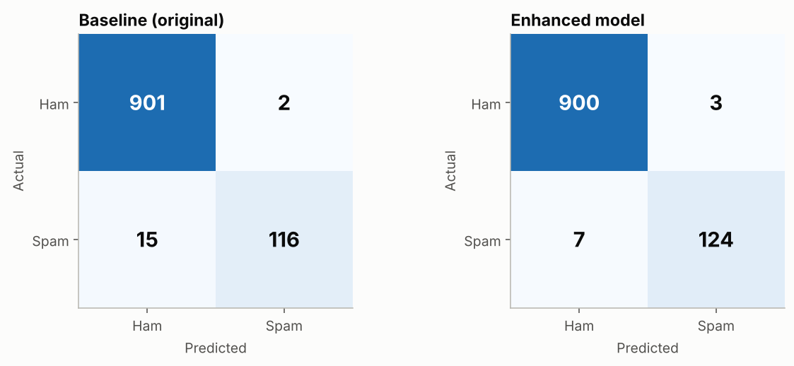
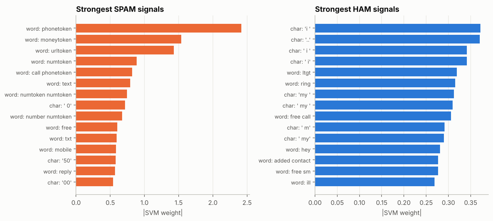

# SMS Spam Classification using SVM — Enhanced

A machine learning project that classifies SMS messages as **Spam** or **Ham** (not spam) with a
Support Vector Machine.

The project started as a course assignment (word TF‑IDF + `LinearSVC`). This version keeps that
work as a **baseline** and extends it with better features, model comparison, explainability, error
analysis, a saved model, a command‑line tool and a web app.

## Highlights

| Test set (1,034 messages) | Baseline (original) | **Enhanced** |
|---|---|---|
| Accuracy | 98.36% | **99.03%** |
| Spam recall (spam caught) | 88.55% | **94.66%** |
| Spam precision | 98.31% | 97.64% |
| F1‑score (spam) | 93.17% | **96.12%** |
| ROC‑AUC | 99.59% | **99.86%** |
| Missed spam messages | 15 | **7** |
| False alarms (ham marked spam) | 2 | 3 |

**The enhanced model misses about half as much spam** (15 → 7), at the cost of one extra false
alarm. 5‑fold cross‑validation on the full dataset confirms this: F1 rises from 92.04% to 96.25%.

> The baseline row is the original pipeline re‑run with the same split. The original notebook
> reported 98.45% accuracy; the small difference (one message) comes from newer library versions.



## What's new compared to the original project

| # | Enhancement | Details |
|---|---|---|
| 1 | **Smarter text cleaning** | Links, e‑mails, prices, phone numbers and other numbers become `urltoken`, `emailtoken`, `moneytoken`, `phonetoken`, `numtoken`. The original deleted them, yet 73% of spam has a phone number and 50% mentions a price |
| 2 | **Character n‑grams** | 2–5 character TF‑IDF on the raw text catches slang and disguised words (*fr33*, *txt*, *c-h-e-a-p*) |
| 3 | **Meta features** | Length, digit ratio, CAPS ratio, `!` count, URL/phone/price/e‑mail flags |
| 4 | **Classifier comparison** | Naive Bayes, Logistic Regression, KNN, Random Forest, RBF SVM and linear SVM |
| 5 | **Ablation study** | Measures the gain from each enhancement separately |
| 6 | **Larger grid search, optimised for F1** | Tunes `C`, `class_weight` and the feature set. Accuracy is misleading when 87% of messages are ham |
| 7 | **Probability output** | `CalibratedClassifierCV` turns SVM scores into a spam probability |
| 8 | **Full evaluation** | Confusion matrix, ROC and precision‑recall curves, decision‑threshold analysis |
| 9 | **Explainability** | Top spam and ham features, plus a per‑message explanation of every prediction |
| 10 | **Error analysis and robustness test** | Every misclassified message, plus 12 new hand‑written messages |
| 11 | **Usable project** | Saved model, CLI (`predict.py`), Streamlit web app (`app.py`), unit tests |

## Results

### Which classifier works best?
All classifiers use the same word and character TF‑IDF features (5‑fold CV on the training set,
spam class):

| Model | Precision | Recall | F1 | Train time |
|---|---|---|---|---|
| **SVM (linear)** | 98.20% | 93.67% | **95.87%** | 0.9 s |
| Multinomial Naive Bayes | 97.47% | 94.06% | 95.72% | 1.9 s |
| Logistic Regression | 98.18% | 92.33% | 95.15% | 1.1 s |
| SVM (RBF kernel) | 98.96% | 91.18% | 94.89% | 11.3 s |
| Random Forest | 99.18% | 90.03% | 94.35% | 4.9 s |
| K‑Nearest Neighbours | 98.49% | 86.01% | 91.79% | 0.8 s |

The linear SVM gives the best F1 and is among the fastest, which justifies the original choice of
model.

### What does each enhancement add? (ablation, 5‑fold CV)

| Step | Precision | Recall | F1 |
|---|---|---|---|
| 1. Baseline (original project) | 97.00% | 84.68% | 90.36% |
| 2. + better cleaning (keep URL/phone/£ tokens) | 97.80% | 93.10% | 95.38% |
| 3. + character n‑grams | 98.20% | 93.67% | 95.87% |
| 4. + meta features | 97.83% | 93.86% | 95.79% |
| 5. + balanced class weights | 96.87% | 93.86% | 95.33% |

- **Keeping URL, phone and price tokens is the biggest gain**: spam recall rises by more than 8 points.
- **Character n‑grams** add a further gain in both precision and recall.
- **Meta features don't help** on top of the improved text features, because their information is
  already captured by the tokens. The grid search agrees and leaves them out.

**Final model:** word + character TF‑IDF → `LinearSVC(C=1, class_weight="balanced")`, calibrated
(best CV F1 = 96.10%).

### Explainability


A phone number, a price or a link is the strongest sign of spam. Ham is recognised by
conversational words and characters (*i*, *my*, *hey*, *..*).

### Robustness test (12 new messages, not in the dataset)
The baseline gets 10/12 right; the enhanced model gets 11/12. The enhanced model catches a phishing
link (`www.secure-login-update.com`) and a disguised word (`c-h-e-a-p loans`) that the baseline
misses. It wrongly flags an **OTP message** ("Your OTP is 482913…"). The dataset is from 2011,
before one‑time passwords were common, which shows the limits of an old dataset.

### Error analysis
- **Missed spam** is mostly spam with no phone number or link: adult content, quiz messages,
  promotions written like chat.
- **False alarms** are ham messages about money, such as a bill amount or a tour price.

All figures are in [`results/figures/`](results/figures) and every number above is in
[`results/metrics.json`](results/metrics.json).

## Project structure

```
├── SMS_Spam_SVM (1).ipynb        original course notebook (baseline, unchanged)
├── sms_spam_svm.py               original notebook exported as a script (unchanged)
├── SMS_Spam_SVM_Enhanced.ipynb   enhanced notebook: full walkthrough with outputs
├── train.py                      runs every experiment, saves model + results
├── predict.py                    command‑line predictions (single or CSV)
├── app.py                        Streamlit web app
├── src/
│   ├── preprocessing.py          original + enhanced text cleaners
│   ├── features.py               char n‑grams, meta features, combined features
│   ├── model.py                  model building, calibration, saving, explanations
│   └── plots.py                  shared chart style
├── data/spam.csv                 SMS Spam Collection dataset
├── models/spam_svm.joblib        trained model
├── results/                      metrics, comparison tables, misclassified messages
│   └── figures/                  all charts
├── tests/test_pipeline.py        unit tests
└── requirements.txt
```

## How to run

```bash
git clone https://github.com/SSJemey/SMS_Spam_SVM.git
cd SMS_Spam_SVM
pip install -r requirements.txt
```

**Re‑train everything** (about 3 minutes; rewrites `models/` and `results/`):
```bash
python train.py
```

**Web app**: type a message and see the spam probability and the words behind the decision, or
upload a CSV of messages:
```bash
streamlit run app.py
```

**Command line:**
```bash
python predict.py "Congratulations! You won a £1000 prize. Call 09061743810"
# [Spam]  99.9%  Congratulations! You won a £1000 prize. Call 09061743810

python predict.py --explain "FR33 entry! W1N a £500 prize, txt WIN to 80086 now"
python predict.py --file messages.csv --column message --out predictions.csv
```

**In Python:**
```python
from src.model import load_model, predict_sms, explain
model, info = load_model()
predict_sms(model, "Hi, are we meeting tomorrow at 3 PM?")   # ('Ham', 0.002...)
explain(model, "WIN a free prize, call 09061743810")          # top contributing features
```

**Tests:**
```bash
pytest -q
```

**Google Colab:** open `SMS_Spam_SVM_Enhanced.ipynb` and run the clone/install cell shown at the top.

## Dataset

[SMS Spam Collection](https://archive.ics.uci.edu/dataset/228/sms+spam+collection)
([Kaggle mirror](https://www.kaggle.com/datasets/uciml/sms-spam-collection-dataset)) by
T. A. Almeida and J. M. Gómez Hidalgo, licensed CC BY 4.0.

- 5,572 messages: 4,825 ham, 747 spam
- After removing 403 duplicates: **5,169 messages (4,516 ham, 653 spam)**
- 80/20 stratified split: 4,135 train, 1,034 test (`random_state=42`, same as the original)

## Limitations and future work

- The dataset is old (2011) and mostly UK English, so modern messages such as OTPs and delivery
  scams are under‑represented.
- Spam with no number or link is the main weak spot.
- Possible next steps: newer and multilingual SMS data (e.g. Bangla), transformer models such as
  DistilBERT for comparison, and deploying the app on Streamlit Community Cloud.

## Author

Shanjida Sultana Jemey
